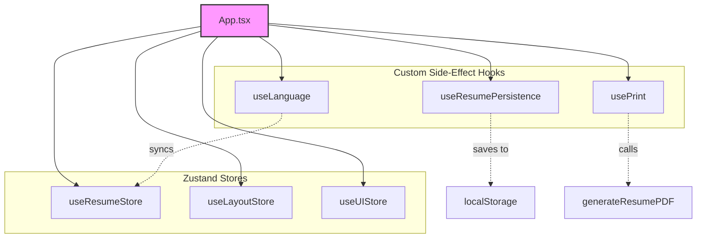
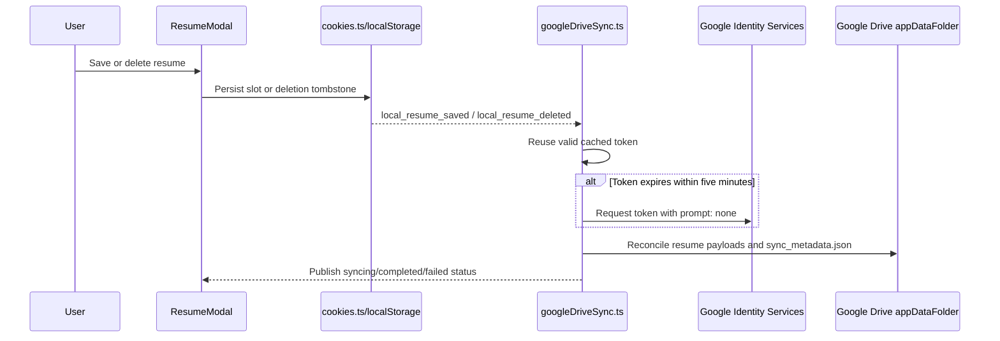

# Architecture Design and Data Flow

This document details the new architectural design, state management layer, custom hooks, and layout flows introduced in the refactoring of the Markdown Resume Generator.

## 🏛️ State Management Architecture

To resolve the complexity of the previous `App.tsx` (which housed multiple independent React state hooks and side-effects), we migrated state to **Zustand** stores located under `src/stores/`. This decouples the core domain state from the visual layout rendering.



### 1. `useResumeStore`
Housed in `src/stores/useResumeStore.ts`, it is the master store containing active CV configurations:
- **Markdown Content**: The active resume draft string.
- **Visual Styles**: Typography, spacing, weights, margins, and custom element styles (`AppStyles`).
- **Layout Templates**: Active CSS layouts (`classic`, `creative`, `minimalist`, etc.).
- **Avoid Page Breaks**: Avoid page split checks and targeting heading levels.
- **Active Language**: Active system and editor language selection (`SupportedLang`).

### 2. `useLayoutStore`
Housed in `src/stores/useLayoutStore.ts`, it manages interface pane sizes and visibility constraints:
- **Sidebar visibility**: Toggles Style configuration panel.
- **Split widths**: Manages left and right pane sizes in pixels dynamically updated by mouse drag resize event listeners.

### 3. `useUIStore`
Housed in `src/stores/useUIStore.ts`, it governs temporal modal status, action loaders, feedback loops:
- **Toasts**: success, error, info notifications.
- **Modals**: Saved CV cookie slots control modal.
- **Tabs**: Active viewport mode (`styles`, `editor`, `preview`) under smaller responsive devices.

---

## 🔗 Custom Side-Effect Hooks

To keep `App.tsx` clean and dedicated solely to rendering layout components, state mutations and background operations are delegated to custom React hooks located under `src/hooks/`:

### 1. `useLanguage`
- Automatically detects user browser local languages and fallback preferences.
- Silent query string URL parameter syncing (`?lang=ja`).
- Modifies dynamic SEO headers (html `lang` attribute, meta descriptions, page title suffixes).
- Resolves default CV boilerplate markups during language switching.

### 2. `useResumePersistence`
- Automatically intercepts store actions and triggers local storage sync operations.
- Preserves the **exact same key schema** (`markdown_resume_content`, `markdown_resume_template`, etc.) to maintain complete backward compatibility for returning users.

### 3. `usePrint`
- Manages exports to Markdown files (`.md`).
- Triggers browser-native print layouts (`window.print()`) that preserve vector structures and full ATS compliance.

---

## ☁️ Google Drive Synchronization

`src/utils/googleDriveSync.ts` owns the Google Identity Services (GIS) authorization flow and synchronization with the Google Drive `appDataFolder`. It subscribes to local resume mutation events at module level, so sync is not tied to whether `ResumeModal` is mounted. `ResumeModal` consumes the status subscription to render connection state, progress, and recoverable errors.



- **Local-first data model:** `cookies.ts` stores full resume payloads and a master metadata list in `localStorage`, then emits `local_resume_saved` or `local_resume_deleted` after a successful mutation. Deletes become timestamped tombstones so they can be propagated instead of returning as zombie items from another device.
- **Conflict resolution:** Sync merges local and remote metadata by resume ID and timestamp. Active records upload/download payloads; newer deletion tombstones remove the corresponding payload and remain in metadata.
- **Token lifecycle:** The access token and absolute expiry timestamp are cached in `localStorage`. A five-minute refresh buffer marks an otherwise valid token as due for renewal; the sync module first calls GIS with `prompt: "none"`, which never opens a popup. Interactive authorization is reserved for an explicit user action such as **Connect Google Drive** or **Sync**. Logout and HTTP 401 responses purge the token cache.
- **Status and recovery:** The module publishes `syncing`, `completed`, `failed`, and `disconnected` transitions to subscribers. A 60-second watchdog aborts stalled requests and exposes a localized error to the modal.
- **Privacy boundary:** There is no application backend. Without user authorization, resume data stays in browser storage; enabled Drive sync sends only the backup records to the user's Google Drive application-data folder.

---

## 📱 Responsive Layout Stacking Flow

When viewport width falls below `1125px`, the layout transitions from a multi-pane side-by-side view to a **mobile-tabbed single-pane view**:
1. Side-by-side pane split width controls and resizing handles are disabled.
2. A sticky mobile navigation tab-bar appears below the header (Tabs: **Styles**, **Editor**, **Preview**).
3. The header action buttons collapse and hide text contents, transforming gracefully into compact icon-only actions on screen sizes under `768px`.

---

## 🔐 /cipher Encryption Tool

A second Vite entry (`cipher/index.html`, `src/cipher/`) served at `/cipher/`. It shares only the origin with the resume tool: `src/cipher/` may not import from any other `src/` directory (enforced by `src/cipher/__tests__/guards.test.ts`), has its own stylesheet, and ships none of the analytics, stores, cookies, storage or Drive code.

### Architecture

```
cipher/index.html         strict CSP meta, no inline script
src/cipher/main.tsx       React root
src/cipher/App.tsx        module switch, language, wipe triggers, same-origin isolation check
src/cipher/components/    tabs, textarea fields, key exchange and password modules
src/cipher/crypto/        encoding (prefixed base64url), kem (X-Wing), password (Argon2id), aead (AES-GCM), secrets
src/cipher/workers/       Argon2id Web Worker + client
```

- **Key exchange:** X-Wing (`ml_kem768_x25519` in `@noble/post-quantum`, draft-connolly-cfrg-xwing-kem; 32-byte seed private key, 1216-byte public key, 1120-byte KEM ciphertext). Encrypt: encapsulate to the recipient key (anonymous sender), `HKDF-SHA256(ss, info = "cipher/v1" ‖ kem_ct)` → AES-256 key + 12-byte nonce, AES-256-GCM with `header ‖ kem_ct` as AAD. The AES key is imported as a non-extractable `CryptoKey`.
- **Password:** Argon2id (64 MiB, t=3, p=1) in a Web Worker; parameters, salt and nonce live in the ciphertext header, which is also the AAD. Parameters read from untrusted headers are bounded before use.
- **Random passphrase:** the key-exchange encrypt tab can fill the plaintext with a BIP-39 mnemonic (24 words from the standard English 2048-word list, 256-bit entropy plus checksum, via `@scure/bip39` and `crypto.getRandomValues`), joined with `-`.
- **Errors:** every decryption failure maps to the same message; errors never contain input.
- **State:** React `useState` only. `Workspace` is remounted on wipe, and tracked `Uint8Array` secrets are `fill(0)`-ed. Wipe fires on `pagehide`, on `pageshow` with `persisted` (bfcache), after five minutes without user interaction, and from the clear button (including five minutes of inactivity). Nothing goes in the URL.
- **Inputs:** textareas only (no `<form>`, no `type=password`), `autocomplete/autocorrect/autocapitalize=off`, `spellcheck=false`, password-manager opt-out attributes; secrets are masked with `-webkit-text-security` (engines without it hide the glyphs and show a character count). Refresh, reopen-closed-tab and session restore behavior still requires real Chrome and Firefox testing. If content is restored, a non-restoring `contenteditable` approach must be evaluated and accessibility rechecked.
- **Output:** no auto-copy; manual copy only; clipboard clearing is attempted after 30 seconds only if a permitted clipboard read confirms the content is unchanged (best-effort; may fail silently). Private keys cannot be downloaded; ciphertext download carries an on-disk warning.
- **Isolation:** the page refuses to run when `window.opener` is set or when framed. This cannot block arbitrary same-origin scripts.

### CSP and build

`default-src 'none'; script-src 'self'; style-src 'self'; worker-src 'self'; connect-src 'none'; img-src 'self'; font-src 'none'; manifest-src 'self'; form-action 'none'; base-uri 'none'`. `img-src 'self'` (rather than `'none'`) is required because Chromium applies `img-src` to the same-origin favicon, and `manifest-src 'self'` lets the same-origin web app manifest load. Vite's modulepreload polyfill is disabled because it issues network requests. The password worker may fetch a same-origin script when password mode is first used; this does not upload secrets but means a literal zero-network-requests-after-load assertion is not yet met. For `vite dev` only, the CSP meta is stripped (React refresh injects an inline script); test CSP with `npm run build && npm run preview`.

`build.guard.test.ts` builds the site and scans everything the cipher page loads for forbidden APIs (cookies, storage, IndexedDB, caches, service workers, network APIs, beacons, analytics, `console.log`, `Math.random`), checks the CSP, and rejects inline scripts. The only allowed `Math.random` is React DOM's internal property-key suffix.

### Password strength hint

`src/cipher/crypto/strength.ts` estimates entropy (character-class pool size over distinct characters; an all-BIP-39-words phrase counts 11 bits per word). Below 128 bits the password tab shows a red warning; weak passwords are never rejected.

### App-like mode

The page is laid out like a mobile app: full-height shell with only the active panel scrolling, the module switch at the top on all screen sizes, safe-area insets, 16px inputs (prevents inadvertent iOS focus-zoom), `touch-action: manipulation`, and a viewport with user zoom enabled. A web app manifest (`display: standalone`, scoped to `/cipher/`) and the Apple/Chrome standalone meta tags allow "Add to Home Screen". There is deliberately no service worker, so it does not work offline and nothing is cached by the app. User zoom remains enabled for accessibility.

### Threat model

Protects against: content persisting in the page's own storage, content being sent by the page, autofill/password-manager capture, other tabs of the same origin reading the page (opener/frame refusal), and stale content surfacing after close/bfcache.

Residual traces the page cannot eliminate:

- GitHub Pages access logs and the visit appearing in browser history and caches.
- Clipboard and OS clipboard history (the page attempts to clear an unchanged clipboard after 30 seconds, but history and permission controls are outside its control).
- Browser extensions, AI side panels, screen recorders and accessibility tools.
- Memory paging/swap and JavaScript strings, which cannot be zeroed.
- A tampered or replaced page: the code is delivered by GitHub Pages on every visit, so a compromised deployment or CDN could ship malicious code.
- Same-origin risk from the resume tool: an XSS there would reach `/cipher`, hence the DOMPurify fix; the opener/frame check does not stop a script running in another same-origin tab.

---

## ₿ /btc Wallet Generator

A third Vite entry (`btc/index.html`, `src/btc/`) served at `/btc/` (GitHub Pages redirects `/btc` to `/btc/`; the dev and preview servers mirror that). It reuses the cipher page's CSS, fields, wipe and isolation helpers and the same strict CSP (`connect-src 'none'`), so it can only generate, never send or query balances.

- **Entropy:** 32 bytes from `crypto.getRandomValues`, optionally hashed with user-typed extra input (`SHA-256("btc-wallet/v1" ‖ random ‖ extra)`). A constant or wrong-length random source is refused.
- **Seed:** 24-word BIP-39 (English), no passphrase. Restore tab validates the checksum.
- **Addresses:** BIP-84 `m/84'/0'/0'/0/i` native SegWit (`bc1q…`) via `@scure/bip32` and `@scure/btc-signer`; checked against the official BIP-84 test vector. WIF keys are masked until revealed.
- `src/btc/__tests__/build.guard.test.ts` scans the built page for forbidden APIs and checks the CSP.
